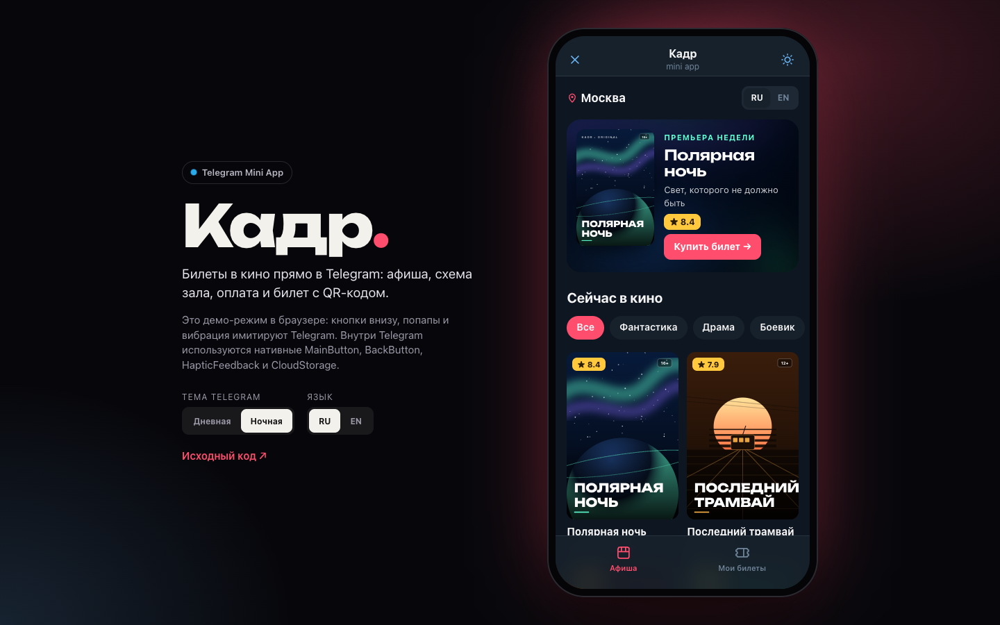
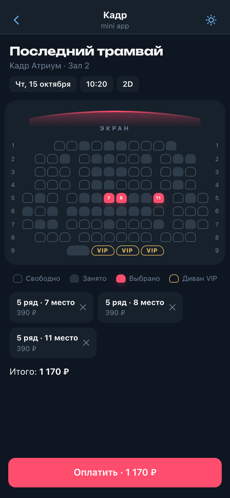

<div align="center">

# Кадр

**Telegram Mini App для покупки билетов в кино** · RU / EN

<a href="https://cdduke.github.io/kadr-miniapp/"></a>

     

&nbsp;

*🇬🇧 Cinema tickets inside Telegram — native MainButton / BackButton / popups / haptics / CloudStorage, theme-aware UI, auto-sized seat map, QR tickets and an aiogram bot that receives them.*

</div>

---

Мини-приложение кинотеатра, которое открывается прямо в Telegram: афиша, сеансы на неделю, схема зала
с выбором мест, оплата (демо) и электронный билет с QR-кодом. В комплекте — **бот на aiogram 3**,
который запускает приложение и присылает подтверждение билета в чат.
**Двуязычный интерфейс: русский (по умолчанию) и английский** — язык берётся из настроек Telegram.

**Стек:** React 19 · TypeScript (strict) · Zustand · Motion · Telegram Mini Apps API · Vite · Python / aiogram 3

## Возможности

- **Нативные элементы Telegram**: MainButton с суммой заказа и индикатором оплаты, BackButton для навигации
  по стеку экранов, `showPopup` для подтверждения, HapticFeedback на каждое действие, CloudStorage для билетов
  (с откатом на `localStorage` в старых клиентах)
- **Тема клиента**: интерфейс построен на CSS-переменных `--tg-theme-*`, поэтому сам подстраивается под светлую,
  тёмную и любую пользовательскую тему Telegram; цвет шапки и фона синхронизируется
- **Демо-режим в браузере**: те же вызовы управляют встроенной имитацией шапки, MainButton и попапов,
  можно переключить дневную и ночную тему Telegram
- **Афиша**: процедурные SVG-постеры (без картинок), премьера недели, фильтр по жанрам
- **Расписание** на 7 дней по трём кинотеатрам и пяти залам (IMAX, VIP) — детерминированное, одинаковое у всех;
  прошедшие сеансы недоступны
- **Схема зала**: размер мест подбирается под ширину экрана (ResizeObserver), проходы, VIP-диваны парами,
  до 6 мест в заказе, уже купленные места отображаются занятыми
- **Билет**: QR-код (кодировщик грузится лениво, только при открытии билета), отрывная линия, «Поделиться»,
  раздел «Мои билеты» со счётчиком на вкладке
- **Отправка билета боту** через `sendData` — кнопка появляется только когда приложение открыто
  с клавиатуры бота (только там Telegram разрешает этот метод)
- Анимированные переходы между экранами, `prefers-reduced-motion` учитывается

## Бот

`bot/main.py` — `/start` с кнопкой запуска приложения на клавиатуре, кнопка меню чата, приём `web_app_data`
и ответ с оформленным билетом. Данные из приложения считаются недоверенными: каждое поле экранируется
и обрезается.

```bash
cd bot
python3 -m venv .venv && source .venv/bin/activate
pip install -r requirements.txt
cp .env.example .env    # BOT_TOKEN от @BotFather, WEBAPP_URL — HTTPS-адрес собранного приложения
python main.py
```

## Качество

- Проверено сценарием в headless Chrome на 390, 820 и 1440px: афиша → сеанс → места → подтверждение →
  оплата → билет с QR → «Мои билеты», смена темы и языка — без ошибок в консоли
- Строгий TypeScript, ни одного `any`; разметка кнопок валидна (только phrasing-контент), у постеров
  корректные ARIA-атрибуты

## Запуск

```bash
npm install
npm run dev      # http://localhost:5182
npm run build    # tsc + сборка
```

---

*Cinema Mini App built as a portfolio piece. Films, cinemas and schedules are fictional; payment is a demo. Bilingual: Russian / English.*

**Демо:** https://cdduke.github.io/kadr-miniapp/
